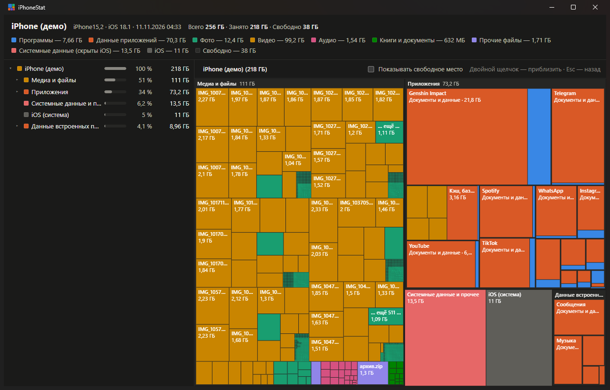

# iPhoneStat

WinDirStat, только для iPhone. Подключаете телефон кабелем к компьютеру с Windows — и видите на одной
карте, что именно съело память: чем больше прямоугольник, тем больше места он занимает.



## Зачем это нужно

Память на iPhone заканчивается у всех, а сам телефон отвечает на вопрос «куда она делась» очень
скупо: полоска в настройках и список приложений. Отсюда и появилась эта программа.

- **Видно, что удалять.** Одно видео на 2 ГБ, забытый архив в загрузках, игра с кэшем на 20 ГБ —
  на карте такие вещи бросаются в глаза сразу, а в настройках телефона до них ещё надо докопаться.
- **Фото и видео можно забрать на компьютер без iCloud и без «импорта» с его сюрпризами.** Выбрали
  папку `DCIM`, нажали «Скопировать на ПК», указали куда — получили обычные файлы в обычной папке.
  На телефоне при этом ничего не меняется и не удаляется.
- **Резервная копия перед тем, как что-то чистить.** Полная копия в том же формате, что делает
  iTunes, — её потом можно восстановить штатными средствами Apple.
- **Ничего не уходит в интернет.** Программа общается только с телефоном по кабелю. Ни аккаунтов,
  ни облака, ни телеметрии.
- **Не нужен джейлбрейк**, и на сам телефон ничего не ставится.

## Как пользоваться

1. Поставьте iTunes или «Устройства Apple» из Microsoft Store — вместе с ними в систему приходит
   служба, через которую Windows вообще видит iPhone. Если телефон у вас уже когда-то
   синхронизировался с этим компьютером, она уже есть.
2. Подключите iPhone кабелем, разблокируйте и ответьте «Доверять».
3. Запустите `iPhoneStat.exe`. Откроется окно, программа сама найдёт телефон и через минуту-другую
   покажет карту.

Дальше всё мышкой:

- щелчок по прямоугольнику или строке в списке слева выбирает объект, двойной щелчок приближает,
  `Esc` возвращает назад;
- «Скопировать … на ПК» копирует выбранную папку или файл туда, куда вы укажете;
- когда копирование закончилось, «Показать в проводнике» откроет папку с выделенной копией;
- «Резервная копия iPhone…» делает полную копию телефона;
- «Обновить» сканирует телефон заново — удобно после того, как что-то удалили.

Существующие файлы на компьютере программа не перезаписывает: если папка с таким именем уже есть,
копия ляжет рядом как «DCIM (2)».

## Чего программа не умеет — и почему

Честно о границах, чтобы не было разочарований. Все они идут от самой iOS, а не от лени автора.

- **Внутрь приложений заглянуть нельзя.** iOS сообщает компьютеру только общий размер каждого
  приложения: сколько весит сама программа и сколько её данные. Что именно лежит в этих данных
  (переписка, кэш, скачанные серии) — не видно. Исключение — приложения, которые сами открыли свою
  папку для компьютера, например VLC.
- **«Системные данные и прочее» — это остаток.** Кэши, почта, сообщения и всё остальное, что iOS
  прячет, собрано в один блок; его размер посчитан как «занято минус всё, что удалось увидеть».
- **Удалять с телефона программа не умеет** — и это сделано намеренно. Она только показывает и
  копирует. Удаляете вы сами, на телефоне.
- **Если включена «Оптимизация хранилища» в iCloud Фото**, оригиналы части снимков лежат в облаке,
  а не на телефоне. Скопируется только то, что реально есть на устройстве.
- Только Windows 10 и 11, только по кабелю.

## Где что лежит на компьютере

- Отчёты: каждый скан сохраняется отдельной HTML-страницей в `%LOCALAPPDATA%\iPhoneStat\reports`.
  Её можно открыть в браузере позже, уже без телефона.
- Журнал работы: `%LOCALAPPDATA%\iPhoneStat\iphonestat.log` — пригодится, если что-то пошло не так.

В отчётах есть имена ваших файлов и приложений, так что не выкладывайте их куда попало.

## Сборка из исходников

Нужен Python 3.10 или новее.

```
python -m venv .venv
.venv\Scripts\python -m pip install -r requirements-dev.txt
.venv\Scripts\python build.py
```

Готовый файл появится в `dist\iPhoneStat.exe`. Он один, без установщика и без консольного окна.

Запустить без сборки: `.venv\Scripts\python -m iphonestat`. Посмотреть, как всё выглядит, не
подключая телефон: добавьте `--demo`. Остальные ключи покажет `--help`.

Тесты и линтер:

```
.venv\Scripts\python -m pytest
.venv\Scripts\python -m ruff check .
```

Настоящий iPhone тестам не нужен — службы устройства заменены заглушками.

## Как это устроено

С телефоном программа разговаривает через библиотеку
[pymobiledevice3](https://github.com/doronz88/pymobiledevice3) — по тем же протоколам, что и iTunes.
Интерфейс — HTML-страница в собственном окне (WebView2), которую отдаёт маленький локальный сервер.
Он слушает только `127.0.0.1` и принимает команды только от этой страницы.

| Файл | Что делает |
|------|------------|
| `iphonestat/device.py` | подключение к iPhone и сканирование |
| `iphonestat/tree.py` | дерево «что занимает место» |
| `iphonestat/transfer.py` | копирование папок и резервная копия |
| `iphonestat/jobs.py` | фоновые задания с прогрессом и отменой |
| `iphonestat/session.py` | сканирование в фоне и экран ожидания |
| `iphonestat/server.py` | локальный сервер приложения |
| `iphonestat/window.py` | окно приложения |
| `iphonestat/app.py` | собирает всё вместе |
| `iphonestat/template.html`, `waiting.html` | страница с картой и экран ожидания |

Проект не связан с Apple. iPhone, iTunes и iCloud — товарные знаки Apple Inc.
